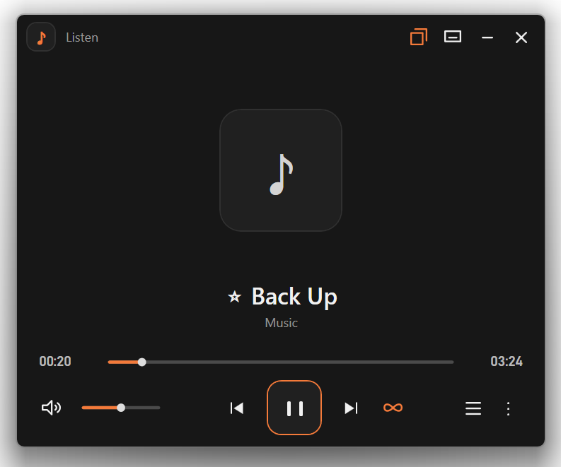
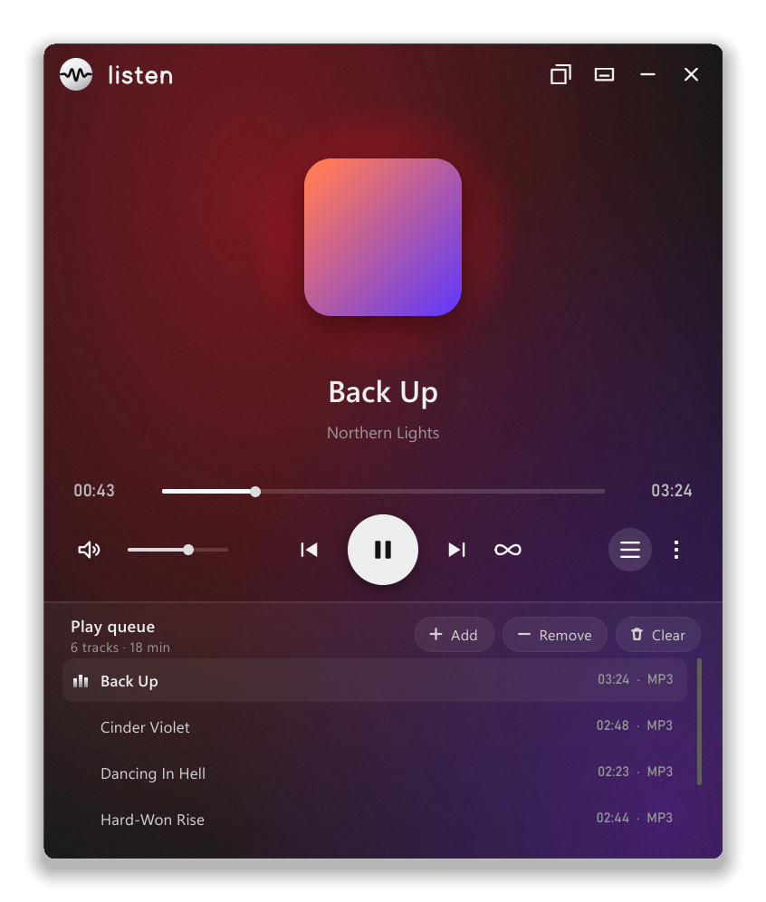

<div align="center">

# Listen

**A tiny, audio-only player for Windows, built around what I wanted for myself: open a file, listen, and keep everything else out of the way.**

Native, minimal, and private.

**Windows 10/11 · MIT · No Electron · No account · No telemetry**

[**Download Listen →**](https://github.com/bemorin/listen/releases/latest)

[Releases](https://github.com/bemorin/listen/releases) · [Bemorin](https://bemorin.com) · [MIT License](LICENSE.md)

</div>

<p align="center">
  
</p>

## Why Listen?

Listen started from a simple personal need: I wanted a small audio player that opened quickly and stayed out of the way.

Something I could use for a single file or a small queue without opening a full media library, video player, streaming interface, or anything else I did not need.

I still wanted the useful parts — drag & drop, repeat, a mini player, taskbar controls, Windows integration, and the option to keep the player above other windows.

That became Listen.

## Features

- **Focused audio playback** — MP3, WAV, WMA, M4A, AAC and FLAC
- **Minimal interface** — playback controls without a media-library UI
- **Mini player** — compact controls when you want Listen out of the way
- **Always on top** — keep the full player or mini player above other windows
- **Play queue** — add several files and keep the queue between launches
- **Drag & drop** — drop audio directly into the player or queue
- **Repeat modes** — repeat the queue or the current track
- **Artwork** — displays available Windows artwork with a lightweight fallback
- **Taskbar controls** — Previous, Play/Pause, Next and Repeat from the Windows taskbar preview
- **Windows integration** — Open with Listen, Default Apps and File Explorer actions
- **Local by default** — no account, telemetry, cloud library or network requirement for playback

## Quick start

Download the latest version from [GitHub Releases](https://github.com/bemorin/listen/releases/latest).

### Installer

Use:

```text
Listen-Setup-<version>.exe
```

Listen is installed for your Windows user and registered with Windows.

No administrator rights are required.

### Portable

Or download:

```text
Listen-Portable-<version>.zip
```

Extract it and launch `Listen.exe`.

No installation required.

## Mini player

Switch to mini mode when you only want the essentials on screen.

<p align="center">
  
</p>

The mini player keeps playback, progress and repeat controls available while using very little screen space.

Both the full player and mini player can stay **always on top**.

## Play queue

Add several files at once, drag audio into the queue, jump to a track, remove items or clear the queue.

<p align="center">
  
</p>

The queue is stored locally and can persist between launches.

## Windows integration

Listen integrates with Windows while leaving the final choice of default application to you.

Once installed, Listen can appear in:

- **Open with / Choose another app**
- **Default apps**
- **Play with Listen**
- **Add to Listen play queue**

Selecting several audio files and choosing **Play with Listen** adds them to the queue and starts with the first track.

Listen never silently overrides your Windows default-app choice.

## Keyboard shortcuts

| Shortcut | Action |
| --- | --- |
| `Space` | Play / pause |
| `←` / `→` | Seek -5 s / +5 s |
| `Ctrl+O` | Add audio files |
| `Ctrl+L` | Show / hide play queue |
| `Ctrl+M` | Mini mode |
| `Ctrl+T` | Always on top |
| `Ctrl+R` | Cycle repeat mode |
| `Delete` | Remove selected queue item |
| `Esc` | Restore from mini mode |

## Privacy

Listen works with your local audio files and stores its preferences and play queue locally.

There is:

- no account
- no telemetry
- no analytics
- no cloud sync
- no network requirement for playback

Local state is stored in:

```text
%APPDATA%\Listen
```

## Build from source

Listen is a native Windows application built with WPF/.NET Framework and Windows media capabilities.

Clone the repository and run:

```bat
build-windows.bat
```

A successful release build creates the installer and portable package inside `release/`.

No Electron, Chromium, Node.js or bundled browser runtime is required.

## Contributing

Contributions are welcome.

Found a bug? Have an idea? Want to improve Listen?

You can [open an issue](https://github.com/bemorin/listen/issues) or submit a pull request.

When contributing, please keep the core principles of Listen in mind:

- **Small and focused**
- **Native where possible**
- **No unnecessary dependencies**
- **Fast to open and use**
- **Local-first**
- **Minimal interface**
- **Focused improvements over feature sprawl**

For larger changes, opening an issue first is a good way to discuss the direction before working on an implementation.

## Platform support

Listen 1.x is currently **Windows-only**.

Native macOS and Linux versions are possible future directions, provided they can preserve the same idea: **small, fast and platform-native**.

The project does not plan to adopt Electron simply to claim cross-platform support.

## Support Listen

Listen is free and open source.

If you find it useful, the easiest ways to support the project are to:

- ⭐ [star the repository](https://github.com/bemorin/listen)
- share Listen with someone who might find it useful
- report bugs or suggest focused improvements
- contribute code or documentation

## License

Listen is open source under the [MIT License](LICENSE.md).

See [CHANGELOG.md](CHANGELOG.md) for public release notes.

---

You can follow me on X at [@benmorinbm](https://x.com/benmorinbm) for updates and new projects, or visit [bemorin.com](https://bemorin.com).