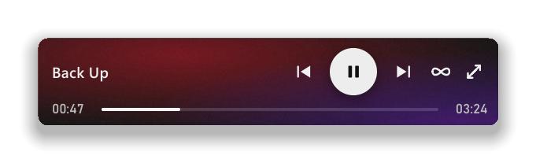

<div align="center">

# Listen

**A tiny, audio-only player for Windows, macOS and Linux, built around what I wanted for myself: open a file, listen, and keep everything else out of the way.**

Native, minimal, and private.

**Windows · macOS · Linux · MIT · No Electron · No account · No telemetry**

[**Download Listen →**](https://github.com/bemorin/listen/releases/latest)

[Releases](https://github.com/bemorin/listen/releases) · [Bemorin](https://bemorin.com) · [MIT License](LICENSE.md)

</div>

<p align="center">
  
</p>

## Why Listen?

Listen started from a simple personal need: I wanted a small audio player that opened quickly and stayed out of the way.

Something I could use for a single file or a small queue without opening a full media library, video player, streaming interface, or anything else I did not need.

I still wanted the useful parts: drag & drop, repeat, a mini player, media keys, and the option to keep the player above other windows.

That became Listen.

## Features

- **Focused audio playback**: MP3, WAV, M4A (AAC and ALAC), AAC and FLAC, decoded the same way on every system
- **Minimal interface**: playback controls without a media-library UI
- **Light and glass**: a neutral black, white and silver interface; the colour comes from the music, as each track's artwork softly tints the window
- **Mini player**: compact controls when you want Listen out of the way; resize it down to just its buttons
- **Adaptive window**: shrink the player and it moves through artwork, compact and mini layouts, then settles on the nearest one
- **Smooth transitions**: the window morphs between the full player, the mini player and the queue
- **Always on top**: keep the full player or mini player above other windows
- **Play queue**: add several files, reorder them by dragging, and keep the queue between launches; the list follows the playing track
- **Drag & drop**: drop audio files anywhere on the window
- **Repeat modes**: repeat the queue or the current track
- **Artwork**: embedded cover art, or `cover.jpg` / `folder.jpg` next to the files
- **Media keys**: keyboard media keys, headset buttons and the system media panel (Windows media flyout, macOS Now Playing, Linux MPRIS)
- **Lightweight**: about 5 MB of memory while playing and about 2 % of one CPU core
- **Local by default**: no account, telemetry, cloud library or network requirement for playback

## Lightweight by design

Listen 2 is written in Rust with a native UI ([Slint](https://slint.dev), software renderer). There is no browser engine and no runtime. The audio device opens on Play and is released after a pause. While playing, the window redraws only as often as the progress bar needs to glide.

Measured on Windows 11 while playing the same 4-minute MP3 (memory as shown in Task Manager):

| | Listen 1.x (previous Windows version) | Listen 2 |
| --- | --- | --- |
| Memory while playing | 38.9 MB | **5.3 MB** |
| Memory at idle | 49.8 MB | **4.7 MB** |
| CPU while playing | 2.5 % of one core | **1.8 %** |
| App size | 130 KB (uses the .NET Framework built into Windows) | 8.7 MB, self-contained |

Details and methodology: [`cross/README.md`](cross/README.md).

## Quick start

Download the archive for your system from [GitHub Releases](https://github.com/bemorin/listen/releases/latest):

| System | File | Then |
| --- | --- | --- |
| Windows 10/11 (x64) | `Listen-<version>-windows-x64.zip` | Extract it anywhere and launch `Listen.exe`. No installation and no administrator rights required. |
| macOS 11+ (Apple silicon) | `Listen-<version>-macos-arm64.zip` | Extract it and move `Listen.app` to Applications. |
| macOS 11+ (Intel) | `Listen-<version>-macos-x64.zip` | Same as above. |
| Linux (x64) | `Listen-<version>-linux-x64.tar.gz` | Extract it and run `./listen`. |

- **macOS**: the app is not notarized yet, so the first time, right-click `Listen.app` and choose **Open**.
- **Linux**: Listen uses ALSA and D-Bus, which every desktop has. The "Add audio files" dialog uses `zenity` (GNOME) or `kdialog` (KDE).
- **Coming from Listen 1.x on Windows**: your play queue and settings are imported on first launch, and Listen 1.x is left untouched. Uninstall it from Windows Settings whenever you like.

## Mini player

Switch to mini mode when you only want the essentials on screen.

<p align="center">
  
</p>

The mini player keeps the title, playback, progress and repeat controls available while using very little screen space. Narrow it and it keeps just its five buttons.

The mini player stays above other windows; the full player can too, with **always on top**.

## Play queue

Add several files at once, drop audio onto the window, jump to a track, drag tracks into a new order, remove items or clear the queue.

<p align="center">
  
</p>

The queue shows each track's length and the queue's total. It is stored locally and persists between launches.

## Keyboard shortcuts

| Shortcut | Action |
| --- | --- |
| `Space` | Play / pause |
| `←` / `→` | Seek -5 s / +5 s |
| `↑` / `↓` | Volume up / down |
| `Ctrl+O` or `+` | Add audio files |
| `Ctrl+L` | Show / hide play queue |
| `Ctrl+M` | Mini mode |
| `Ctrl+T` | Always on top |
| `Ctrl+R` | Cycle repeat mode |
| `-` or `Delete` | Remove the selected queue item |
| `Ctrl+A` | Select the whole queue (then `-`, `Delete` or Remove clears it) |
| `Enter` | Play the selected queue item |
| `Esc` | Cancel a selection, or restore from mini mode |

On macOS, use `⌘` instead of `Ctrl`.

## Privacy

Listen works with your local audio files and stores its preferences and play queue locally.

There is:

- no account
- no telemetry
- no analytics
- no cloud sync
- no network requirement for playback

Local state is stored in:

| System | Folder |
| --- | --- |
| Windows | `%APPDATA%\Listen` |
| macOS | `~/Library/Application Support/Listen` |
| Linux | `~/.config/Listen` |

## Build from source

Listen 2 lives in [`cross/`](cross/). With a stable Rust toolchain:

```sh
cd cross
cargo build --release
```

The app is `cross/target/release/listen` (`listen.exe` on Windows). Linux needs a few development packages; see [`cross/README.md`](cross/README.md#build). No Electron, Chromium, Node.js or bundled browser runtime is required.

Every change is built and tested for Windows, macOS and Linux by [GitHub Actions](.github/workflows/cross.yml). Pushing a `v*` tag publishes the archives above to a GitHub Release.

The previous Windows app (Listen 1.x, WPF) is kept in [`src/`](src/) for reference and still builds with `build-windows.bat`.

## Platform support

Listen 2 runs on **Windows, macOS and Linux**.

It has been used and tested day to day on Windows 11. The macOS and Linux builds are compiled and unit-tested on every change; feedback from those systems is very welcome.

Not yet in Listen 2 (these were in Listen 1.x for Windows):

- **WMA files**: there is no open-source WMA decoder Listen could use on every system
- **File Explorer integration**: Open with Listen, Default Apps, Play with Listen and Add to Listen play queue
- **Taskbar preview buttons**
- **A single window** when files are opened while Listen is already running

See the full list in [`cross/README.md`](cross/README.md#feature-gaps-and-differences).

The project does not plan to adopt Electron simply to claim cross-platform support.

## Contributing

Contributions are welcome.

Found a bug? Have an idea? Want to improve Listen?

You can [open an issue](https://github.com/bemorin/listen/issues) or submit a pull request.

When contributing, please keep the core principles of Listen in mind:

- **Small and focused**
- **Native where possible**
- **No unnecessary dependencies**
- **Fast to open and use**
- **Local-first**
- **Minimal interface**
- **Focused improvements over feature sprawl**

For larger changes, opening an issue first is a good way to discuss the direction before working on an implementation.

## Support Listen

Listen is free and open source.

If you find it useful, the easiest ways to support the project are to:

- ⭐ [star the repository](https://github.com/bemorin/listen)
- share Listen with someone who might find it useful
- report bugs or suggest focused improvements
- contribute code or documentation

## License

Listen is open source under the [MIT License](LICENSE.md).

The Listen name, logos and app icons are not covered by the MIT License: they remain © Ben Morin, all rights reserved. Forks are welcome under the MIT License, but must use a different name and icon.

See [CHANGELOG.md](CHANGELOG.md) for public release notes.

---

You can follow me on X at [@benmorinbm](https://x.com/benmorinbm) for updates and new projects, or visit [bemorin.com](https://bemorin.com).
