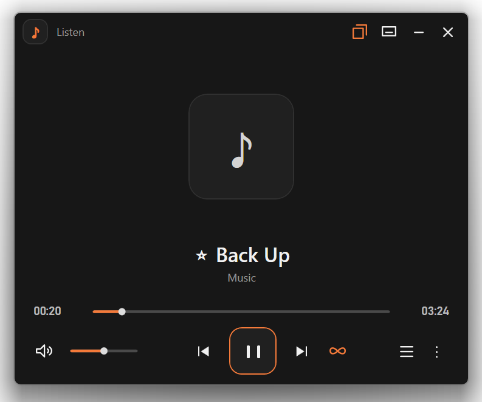
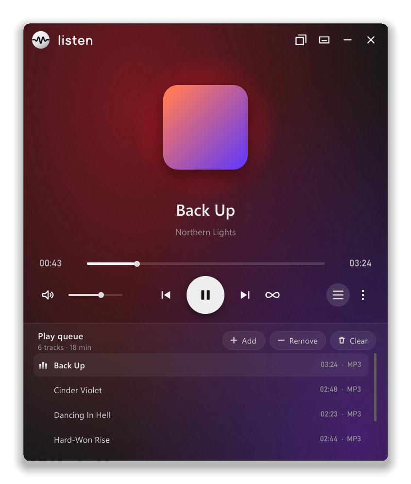
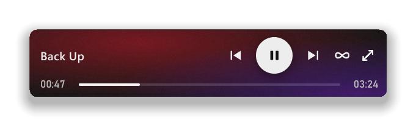

# Listen, cross-platform

A port of Listen to **Windows, macOS and Linux**, written in Rust with a [Slint](https://slint.dev) UI.
It keeps the look and behaviour of the Windows app (`../src`, WPF), and refines the interaction and motion design.

The WPF app stays the reference implementation and is untouched. This folder is self-contained.

<p align="center">
  
</p>

<p align="center">
  
  
</p>

The screenshots use generated demo tracks and covers. The ambient light around the artwork comes from each track's own cover.

## Stack decision

The goal was the lightest possible footprint (binary size and memory) on three operating systems, with a fully custom UI.

| Option | Why not, or why |
| --- | --- |
| Tauri, Electron, Wails | A webview process tree: 30–100 MB of RAM before any UI. |
| Flutter, Avalonia, .NET MAUI | A runtime plus a GPU context: 40–80 MB at idle, 20–60 MB binaries. |
| egui, iced (wgpu/glow) | A GPU context, so the same ~60 MB of driver memory as below, plus continuous repaints. |
| Native toolkits per OS (WinUI, AppKit, GTK) | Three UIs to write and keep identical. |
| **Rust + Slint, software renderer** | **Chosen:** native code, custom UI, no GPU context, no runtime. |

The deciding measurement was a hello window (`bench/hello`, same size and colours as Listen) built with Slint's two desktop renderers. It ran on Windows 11 x64 and was measured as *private working set*, the "Memory" column of Task Manager (`bench/measure.ps1`):

| Hello window | Binary | Memory at idle |
| --- | --- | --- |
| Slint, OpenGL renderer (femtovg) | 6.9 MB | **62.6 MB** |
| Slint, software renderer | 6.9 MB | **4.0 MB** |

The OpenGL driver alone costs about 58 MB. Listen's window is small (500×410 logical px) and mostly static, so drawing it on the CPU is cheap. The software renderer is therefore the right trade-off.

The rest of the stack:

- **Decoding:** [symphonia](https://github.com/pdeljanov/Symphonia), in pure Rust, through [rodio](https://github.com/RustAudio/rodio) (cpal output). The same decoders run on every OS, with no system codecs.
- **Media keys and OS media panel:** [souvlaki](https://github.com/Sinono3/souvlaki). It uses System Media Transport Controls on Windows, MPRIS (D-Bus) on Linux, and Now Playing on macOS.
- **Other apps' playback (remote mode):** the `windows` crate's `Windows.Media.Control` on Windows (same crate and version souvlaki uses) and the `dbus` crate on Linux (the libdbus binding souvlaki already links). See [Remote mode](#remote-mode-other-apps-playback).
- **File dialog:** [rfd](https://github.com/PolyMeilex/rfd) on Windows and macOS (native dialogs). On Linux it shells out to `zenity` or `kdialog`, so Listen links no GUI toolkit.

## Measured footprint (Windows 11 x64, release build)

Both apps ran on the same machine and were measured the same way. Memory is the private working set (Task Manager → Memory); CPU is process time over 15 s. Playback was the same 4:27 MP3. The WPF app was built from `../src` with its own `scripts/build.ps1`.

| | Windows app (WPF, .NET Framework) | Cross-platform app (this folder) |
| --- | --- | --- |
| Binary | 130.5 KB (needs .NET Framework, which ships with Windows) | 8.7 MB, self-contained (no runtime) |
| Memory at idle | 49.8 MB (with a saved queue loaded) | **4.7 MB** (empty queue) |
| Memory while playing | 38.9 MB | **5.3 MB** (full), **3.8 MB** (mini), **6.3 MB** (queue open) |
| CPU while playing | 2.5 % of one core (progress updated 4× a second) | **1.8 %** (full), **1.4 %** (mini), **5.1 %** (queue open, animated bars); the progress bar glides continuously |
| CPU while paused | – | ~0.3 % of one core; the audio device is released after 20 s |

The binary is larger because nothing is borrowed from the OS. The UI toolkit, font shaping, the decoders and image decoding are all inside the executable.

## Build

Requires a stable Rust toolchain (1.85 or newer).

```sh
cd cross
cargo build --release
```

The binary is `target/release/listen` (`listen.exe` on Windows).

- **Windows:** nothing else needed (MSVC toolchain).
- **macOS:** Xcode command-line tools. CI also wraps the binary in `Listen.app` (see `.github/workflows/cross.yml`).
- **Linux (Debian/Ubuntu):** install these packages first.

  ```sh
  sudo apt install pkg-config libasound2-dev libdbus-1-dev libfontconfig1-dev libxkbcommon-dev libwayland-dev
  ```

  At runtime, the "Add files" dialog uses `zenity` (GNOME) or `kdialog` (KDE).

Useful during development:

```sh
cargo test                      # unit tests (names, placement, persistence)
cargo build --release --features test-hooks   # release build that also honours the test hooks below
LISTEN_DATA_DIR=/tmp/listen cargo run -- song.flac other.mp3
```

`LISTEN_DATA_DIR` keeps test state away from your real settings. In debug builds, or with `--features test-hooks`:

- `LISTEN_SILENT=1` mutes the output.
- `LISTEN_DEBUG_CMDS=<file>` drives the app from a command file (`mini`, `queue`, `play`, `next`, `prev`, `repeat`, `topmost`, `seek 0.5`, `size 500 300`), without synthetic input.
- `LISTEN_PAINT_LOG=<file>` logs the duration and size of every frame (Windows).
- `LISTEN_AMBIENT=0|1|2` turns the ambient wash and the grain off for measurements.
- `LISTEN_REMOTE_LOG=<file>` logs every update the remote-mode backend reports. The command file also takes `remote` (toggle the mode), `add <file>` (enqueue without playing) and `playat <n>`; `play`, `next`, `prev` and `seek` go to the mirrored app while it is shown.

GitHub Actions (`.github/workflows/cross.yml`) builds and tests Windows x64, macOS arm64, macOS x64 and Linux x64. It uploads one artifact per platform.

## Usage

The command line is the same as the Windows app's: `listen a.mp3 b.flac` replaces the queue and plays the first file. `listen --enqueue a.mp3` adds files to the queue.

| Shortcut | Action |
| --- | --- |
| `Space` | Play / pause |
| `←` / `→` | Seek −5 s / +5 s |
| `↑` / `↓` | Volume ±5 % |
| `Ctrl+O` | Add audio files |
| `Ctrl+L` | Show / hide play queue |
| `Ctrl+M` | Mini player |
| `Ctrl+T` | Always on top |
| `Ctrl+R` | Cycle repeat mode |
| `Ctrl+Q` / `Ctrl+W` | Quit |
| `+` | Add audio files |
| `-` / `Delete` | Remove the selected queue item |
| `Ctrl+A` | Select the whole queue (then `-`, `Delete` or Remove clears it; `Esc` cancels) |
| `Enter` | Play the selected queue item |
| `Esc` | Leave the mini player |

On macOS, `Ctrl` is `⌘`.

State is stored in `%APPDATA%\Listen` (Windows), `~/Library/Application Support/Listen` (macOS) or `~/.config/Listen` (Linux). The files are `cross-settings.ini` and `cross-queue.txt`, in the same formats as the Windows app. On first launch, the Windows app's `settings.ini` and `queue.txt` are imported; they are never written to.

## What carries over from the Windows app

- The same sizes, spacing and glyph geometry as `UiTokens.cs`. The colours moved to the new palette described below.
- The same layouts: full player, play queue drawer, mini player (title, five buttons, thin progress bar), and the "more" menu.
- **The adaptive window.** Every layout change is a function of the height. Shrinking the window shrinks and fades the artwork, then fades the centred title out before the title-bar title fades in. Below the compact height, the window becomes the mini player. Pulled taller from the mini player, it becomes the full player again.
- **The mini player** is resizable on every edge, down to just its five buttons. Its title hides once it no longer fits.
- **Playback:** play/pause, seek, previous/next with wrap-around on manual skips, repeat off/queue/track, and volume with mute that restores the last level.
- **The persisted queue and settings:** volume, always on top, mini mode, queue visibility, mini width and repeat mode.
- **Always on top.** The mini player is always on top, as in the Windows app.
- **Drag and drop** of audio files onto the window.
- **Media keys,** headset buttons and the OS media panel, with title, artist, album, artwork, duration and position.
- **Window placement rules** (`platform::place`, ported from `WindowMotion.Place`). A morph keeps the top-left corner by default. An edge docked to the screen edge stays docked. Near the bottom or right edge, expanding grows upward or leftward. Collapsing returns to exactly where the window came from.

## Smooth transitions

The Windows app's switches between mini, full and queue are animated here too, without flicker.

The native window bounds animate on the same critically damped spring as the Windows app (`WindowMorph.Ease`). A timer steps the bounds about 140 times per second, and on Windows each step is a single `SetWindowPos` (move and resize in one call).

- **Mini and full player** follow a three-step choreography. The content dissolves (90 ms). The empty window morphs (380 ms). The new layout fades in as the morph settles. Intermediate layouts, such as the compact title-bar title, never flash by.
- **The queue** opens as a drawer: the player stays still while the panel is revealed below it.
- **Manual resizes** play the adaptive layout continuously, because every layout is a function of the height. Released between two layouts, the window settles on the nearer one.

On Windows the steps follow the frames. Each step comes right after the previous size has been painted (the window's `WM_PAINT`) and waits for the compositor (`DwmFlush`), so every new size gets a whole display refresh to be drawn. During a mode change the dissolved content is not drawn at all, and the new layout only appears once the window is nearly at its final size, so the growing steps stay cheap to paint. One residual remains: from a mini player at its minimum width to the full player, a strip of a few pixels can still show for a frame or two at the growing edge. Painting the whole enlarged window takes the software renderer longer than one refresh there.

On macOS and Linux, winit moves and resizes in two calls, so a morph that grows upward near the bottom of the screen may wobble by a pixel. On Wayland, windows cannot position themselves, so they grow from their top-left corner.

## Design refinements in this version

Apple-grade polish, without new weight:

- **Ambient wash, cheaply.** The two artwork glows are rendered once per track into a small image that the window stretches smoothly. Full-window radial gradients cost a lot to draw with the software renderer, and a window morph repaints everything on every step.
- **Light and glass.** The interface is neutral: white glyphs, a white progress bar, and translucent "glass" surfaces with a faint highlight edge (queue drawer, menu, tooltips, pills). The colour comes from the music. Two colours sampled from the artwork, made vivid enough to read as light, bleed softly into the window and cross-fade on track change. Without artwork, the window uses a quiet warm/cool duotone. A fine grain keeps these very soft gradients from banding.
- **New mark.** The orange note becomes a silver disc with a sound wave carved through it; the wave's central peaks draw an M. The icon has no tile and a transparent background, like other taskbar and dock icons. Below 32 px, the wave has fewer oscillations and a thicker line, so it stays legible. A faint edge keeps the disc defined on light taskbars. The same disc is the title-bar logo. It follows playback: the wave shows while music plays and flattens to a straight line, edge to edge, while paused. The change is a single spring per state change, with no looping animation. Next to it is the wordmark "listen": geometric strokes with round terminals, lighter than bold, openly spaced and sized below the mark. It uses no font, so it looks the same on every OS. The app renders it itself at the screen's exact pixel size (`src/wordmark.rs`, with tiny-skia, already in the binary through Slint). Like a hinted font, it uses a whole-pixel stroke and centres every vertical stem on the pixel grid, then shows the result 1:1, so it stays crisp. It is rendered again when the window moves to a monitor with another scale. `assets/make-icon.ps1` renders the PNGs and `assets/make-ico.py` packs `listen.ico`. The palette stays black, white and silver: the queue's now-playing bars are a silver gradient. The Windows app's icon in `../build` is unchanged.
- **Play disc.** Play and pause sit on a light disc with a dark glyph, like a system Now Playing control. It brightens under the pointer and dips when pressed. All other buttons light up as soft circles. Toggle glyphs (always on top, queue, repeat) stay white like every other button; when on, a glass disc sits behind them. Repeat is the same 32 px size as the queue and menu buttons.

- **Artwork.** Embedded cover art is read from MP3, FLAC and M4A tags, or from `cover.jpg` / `folder.jpg` next to the file. It sits on a soft halo tinted with the artwork's own colour, and rests 10 % smaller while paused, with a spring.
- **Transport.** The play and pause glyphs cross-fade with a slight scale. Skip glyphs nudge in their direction when pressed. Hover and press states fade in about 120 ms.
- **Seek bar.** It glides continuously: a local clock re-anchored on the audio clock is sampled at the pace the bar needs, about a sixth of a pixel per frame. A song of a few minutes costs about 11 redraws a second; a short clip costs up to 30. The bar thickens under the pointer, and its thumb grows. A time bubble follows the pointer. Scrubbing previews the time, and the seek happens on release. A click on the duration switches to the remaining time (−03:12), and the choice is remembered.
- **Track changes.** The title and subtitle cross-fade with a slight rise. The artwork dims through the change, and the new cover fades in. Tags are read before the artwork is decoded, so the title is final before the fade ends.
- **Volume.** The icon reflects the level (muted, low, high). A bubble shows the level while you adjust it. The mouse wheel works over the volume slider, and `↑`/`↓` change it. The slider uses a perceptual curve, so it sounds even across its travel.
- **Queue.** The header reads "Play queue · 7 tracks · 24 min", and Add, Remove and Clear are capsules with icons. Titles come from tags, and durations are computed in the background (exactly, even for VBR MP3s without a header). Drag a row to reorder: it lifts with a shadow and follows the pointer, and the rows it passes slide out of its way. Bars bounce beside the playing item. Hovering a row reveals a remove button. Remove and Clear are disabled when they would do nothing.
- **Names.** Under the title comes the artist: the artist tag, else the "Artist - " part of the file name, else the album. Otherwise nothing; a folder name says nothing about the music. "03 - Song.flac" is no longer shown with "03" as the artist.
- **The queue follows playback.** When the track changes with the queue open, the list glides to centre the playing row. Wheel scrolling glides too.
- **Monitors with different scales.** Moving the window to a screen with another scale (150 % and 100 %, say) resizes it. Listen no longer mistakes that for the user resizing (no constraints, snapping or mode change mid-drag).
- **Resting heights.** Released between two layouts after a resize, the window settles on the nearer one (mini, compact, title only, artwork), so it never rests on a half-faded state.
- **Menu.** The "more" menu shows keyboard shortcuts. Its rows compress to fit a short window.
- **Tooltips** use one shared, delayed tooltip with a fade. They flip below the control when there is no room above.
- **Artwork you meant.** Blank `Folder.jpg` placeholders, such as those Windows Media Player leaves behind, are ignored. Artwork embedded in a file is always shown.
- **No flash when the window grows (Windows).** Two causes, both fixed. First, Slint creates its windows transparent by default, so on Windows every pixel not yet painted was see-through: the strip a growing window exposed showed whatever was behind it, often as a white flash. Listen's window is opaque. Second, winit lets Windows erase the background *after* each frame is drawn, which wiped fresh content (the buttons) whenever an erase brush applied. Listen now intercepts background erasing (`platform::erase`). It never erases, and at resize time it fills only the newly exposed strip, with the colour of the window's current edge, until the next frame covers it. Measured frame by frame over queue, mini and always-on-top transitions: no white or flat frames remain. The system border is off too, because its 1 px line showed as a light sliver in the rounded corners.
- **Lightness by design.** The audio device opens on Play and closes after 20 s of pause. While playing, the window redraws only as often as the progress bar needs to glide. Paused, nothing redraws.

## Remote mode (other apps' playback)

When Listen plays nothing of its own, it shows and drives what another app is playing: Spotify, a browser tab, any app that publishes a system media session. The title, artist, artwork, progress, play/pause, previous/next and seeking all use Listen's own interface. The artwork tints the window as Listen's own covers do.

- **What it reads.** On Windows, the Global System Media Transport Controls (`Windows.Media.Control`): the sessions behind the volume flyout's media panel. Listen follows the session Windows shows. Listen's own session is never mirrored, and when Windows' current session is Listen's, Listen picks another app's session, preferring one that plays. On Linux, MPRIS over D-Bus: the player that plays, else the last one followed, else any. Listen's own `org.mpris.MediaPlayer2.listen` is skipped.
- **Clear about whose music it is.** A glass pill beside the wordmark names the app ("Spotify"; packaged apps give their own display name, so the Claude desktop app's browser pane reads "Claude"). Its tooltip reads "Playing in Spotify". In the compact layout the name follows the artist; in the mini player it follows the title. Listen's volume and repeat controls don't apply to another app, so they dim or fade out while mirroring. Previous and next dim when the app can't skip.
- **Local playback always wins.** Playing a track from the queue takes the window back at once. Pausing it hands the window to another app that is still playing. When both are paused, the window stays on whichever it showed last, so Play resumes what you see. With an empty queue, a paused session stays on screen.
- **A setting.** "Follow other apps" in the "more" menu turns the mode off (`remote=0` in `cross-settings.ini`). Off, the backend is dropped: it unsubscribes from the OS and its thread ends. On macOS the item is not shown.
- **Light by construction.** No polling. One thread per backend sleeps until the OS reports a change. On Windows that is session, media-property, playback and timeline events. On Linux it is `NameOwnerChanged`, `PropertiesChanged` and `Seeked` signals on a blocking D-Bus connection. A burst of events is coalesced into one read. Artwork is decoded once per track, off the UI thread, into the same 256 px image the local player uses. Between events the progress bar is extrapolated from the last reported position with the same local clock as local playback. MPRIS never signals the position, so it is read when the state changes.

### Measured cost (Windows 11 x64, release build)

Same machine and method as above: private working set (`bench/measure.ps1`'s counter), CPU as process time over 15–30 s, empty queue. The mirrored app was a browser tab (Chromium, in the Claude desktop app's browser pane) playing a 3-minute track with Media Session metadata and a 400 px cover.

| | Before (no remote mode) | Remote mode off | Remote mode on |
| --- | --- | --- | --- |
| Binary | 8,726,016 bytes | 8,776,192 bytes (+49 KB, +0.6 %) | same |
| Memory, idle, nothing playing anywhere | 4.7–4.8 MB | 4.7–4.8 MB | **5.6–5.7 MB** |
| CPU, idle | 0.00 % | 0.00 % | 0.00 % (no wake-ups) |
| Mirroring a playing tab, full player | – | – | **5.5–5.7 MB, 1.2–3.0 %** of one core |
| Mirroring a playing tab, mini player | – | – | **4.0–4.2 MB, 0.2–0.8 %** |
| Threads | 10 | 10 | 12–15 (the backend's thread, plus the system thread pool that delivers WinRT events) |

- The +0.9 MB with the mode on is the Windows media-session runtime that `GlobalSystemMediaTransportControlsSessionManager` loads, plus the sleeping thread. It is paid even when nothing plays, and is the price of being told about changes rather than asking. Turning the mode off gives back exactly the previous footprint.
- While mirroring, CPU is the progress bar's glide, the same budget as local playback (1.8 % full, 1.4 % mini above). The backend itself reported nothing between user actions during steady playback (checked with `LISTEN_REMOTE_LOG`). Idle CPU readings on this machine are noisy, and single runs of every build, the old one included, reached 0.6–4 % from unrelated load. The table gives the quiet runs.
- Linux was not measured. The MPRIS client was exercised in WSL against a scripted MPRIS player on a private session bus: metadata, artist lists, `file://` artwork, play/pause, next, seek through `SetPosition`, the `Seeked` signal, and shutdown. CI builds and tests it.

### Platform notes

- **Windows.** Seeking needs the app to publish its timeline. Browsers do once a page calls `navigator.mediaSession.setPositionState` (YouTube and most players do). Without one, the time reads 00:00 and the seek bar is disabled. Between reports the position is extrapolated, so an app that loops a track without reporting again shows the bar resting at the end. App names come from Windows for packaged apps (Spotify from the Store, Claude) and are tidied from the app id otherwise ("Chrome", "MSEdge" → "Edge", "Spotify.exe" → "Spotify").
- **Linux.** Only local artwork (`file://`) is shown. Spotify and browsers publish `https://` artwork URLs, and fetching those would put an HTTP and TLS stack into Listen, so those players show the placeholder and the quiet duotone.
- **macOS: not supported, on purpose.** macOS has no public API to read or control another app's playback. The only route is the private MediaRemote framework, and since macOS 15.4 its "now playing" calls answer only Apple-entitled processes. Today's workarounds load the framework through a system binary (for example a `perl` helper) to borrow its entitlement. That is a private-API hack that Apple can break in any update, and it does not belong in a signed, notarised app. So remote mode is absent on macOS and its menu item is hidden. Listen still publishes its own playback to Now Playing through souvlaki. Should Apple ever open a public API, `src/remote` has a backend slot ready.

## Feature gaps and differences

- **WMA is not supported.** No open-source WMA decoder exists in pure Rust (symphonia has none). Supporting WMA would mean Windows-only Media Foundation code, or bundling FFmpeg (tens of MB). `.wma` files are ignored when added.
- **Windows shell integration is not ported:** "Open with", Default Apps registration, "Play with Listen" and "Add to Listen play queue" verbs, and the installer and portable packaging. The command line accepts the same files and `--enqueue`.
- **Single instance:** opening files while Listen runs starts a second window. The Windows app forwards the files to the running instance.
- **Windows taskbar thumbnail buttons** (Previous, Play/Pause, Next, Repeat) are not ported. The OS media panel covers the same controls.
- **macOS:** opening files from Finder ("Open with") arrives as an Apple Event, which winit 0.30 does not expose. Drag and drop and the command line work. The window uses a hidden native title bar, so it keeps macOS's rounded corners and shadow.
- **Linux:** the work area is the whole monitor (no panel detection), and window corners are square.
- **Drop zones:** the Windows app tells the queue and the artwork apart under the pointer. Here a drop anywhere adds to the queue, and plays immediately when nothing was loaded. Not every platform reports the pointer position during an OS drag.
- **Menus and tooltips** are drawn inside the window, as Slint popups. The Windows app's tooltips could extend past its edges.
- **Accessibility:** Slint's screen-reader bridge (AccessKit) is off to keep memory down. Build with `--features accessibility` to turn it on.
- **Testing:** this version was run and tested on Windows 11. macOS and Linux are built and unit-tested in CI, but not yet exercised by hand.

## License

The code is MIT-licensed like the rest of the repository (`../LICENSE.md`). The Listen name, logo and icons (`assets/icon-*.png`, `assets/listen.ico`, and the mark drawn in `ui/app.slint`) are excluded and remain © Ben Morin, all rights reserved.

## Layout of this folder

```text
cross/
  Cargo.toml, build.rs   crate and build script (Slint compile, Windows icon/manifest)
  ui/theme.slint         tokens (UiTokens.cs), motion curves, language, tooltip state
  ui/controls.slint      glyphs, buttons, sliders
  ui/app.slint           the window: full player, queue drawer, mini player, menu, tooltip
  src/main.rs            app controller: queue, playback, window modes and morphs
  src/audio.rs           playback engine (rodio/symphonia), lazy output device
  src/meta.rs            tags, durations, artwork, names
  src/state.rs           persisted settings and queue
  src/platform.rs        work area, atomic move+resize, placement rules, Windows corners
  src/media.rs           media keys and OS media panel (souvlaki)
  src/remote/            remote mode: other apps' playback (mod.rs; windows.rs GSMTC; linux.rs MPRIS)
  src/dialogs.rs         "Add audio files" dialog
  src/wordmark.rs        the "listen" wordmark, rendered at pixel size
  bench/                 hello-window comparison and the memory measurement script
```
